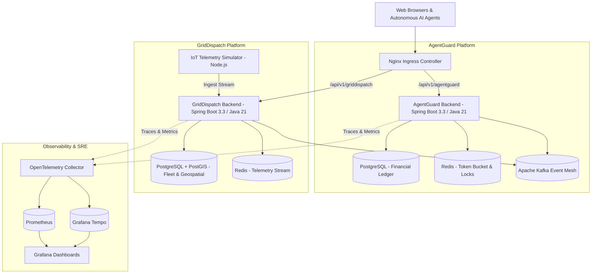
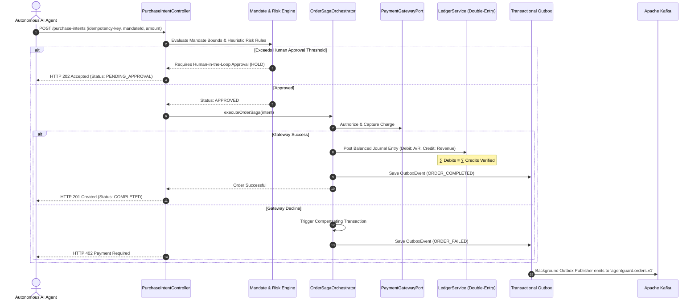
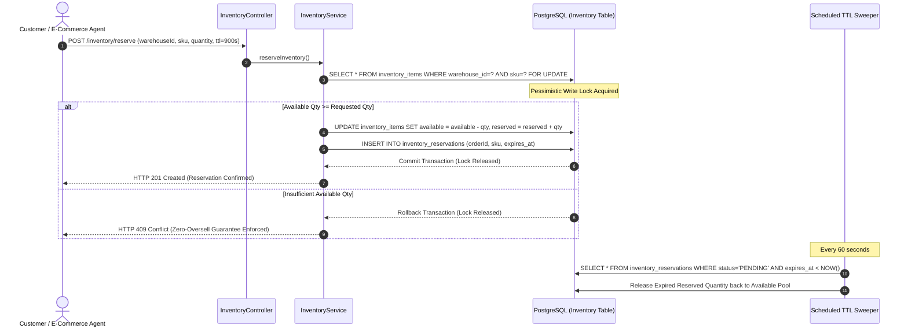

# System Architecture & Technical Specifications

This document outlines the distributed systems architecture, component interactions, saga orchestration flows, and hexagonal boundaries for **AgentGuard** and **GridDispatch**.

---

## 1. High-Level Monorepo Topology



---

## 2. AgentGuard: Hexagonal Architecture & Saga Flow

### 2.1 Hexagonal Layering
AgentGuard separates domain business rules from external technology concerns:
- **Domain Core**: Pure Java entities (`Mandate`, `PurchaseIntent`, `RiskDecision`, `LedgerAccount`, `JournalEntry`). Contains no dependencies on Spring or JPA.
- **Inbound Adapters**: Spring REST Controllers (`PurchaseIntentController`, `LedgerController`) exposing RFC 9457 APIs.
- **Outbound Ports**: `PaymentGatewayPort`, `FraudScorePort`, `NotificationPort`.
- **Outbound Adapters**: `MockPaymentGatewayAdapter`, `OutboxPublisher`, `KafkaProducer`.

### 2.2 Autonomous Order Saga Orchestration
When an AI agent executes a high-value purchase:


---

## 3. GridDispatch: Geospatial Routing & Zero-Oversell Flow

### 3.1 Zero-Oversell Concurrency Control


### 3.2 Pareto Multi-Objective Dispatch Optimization
The dispatch solver balances four competing objective functions:
1. $f_1(x) = \text{Route Duration (minutes)}$
2. $f_2(x) = \text{Carbon Footprint (grams } CO_2e)$
3. $f_3(x) = \text{Battery Wear Cost}$
4. $f_4(x) = \text{Vehicle Capacity Utilization}$

```text
Score(v, o) = w_carbon * (1 - CO2_est / Baseline_CO2) 
            + w_time * (1 - Duration / SLA_max) 
            + w_battery * (SOC_current / 100)
```
Hard constraints:
- $\text{Vehicle Payload} + \text{Order Weight} \le \text{MaxPayloadKg}$
- $\text{Remaining Range} \ge 1.25 \times \text{Route Distance}$
- $\text{Vehicle Status} == \text{IDLE}$
