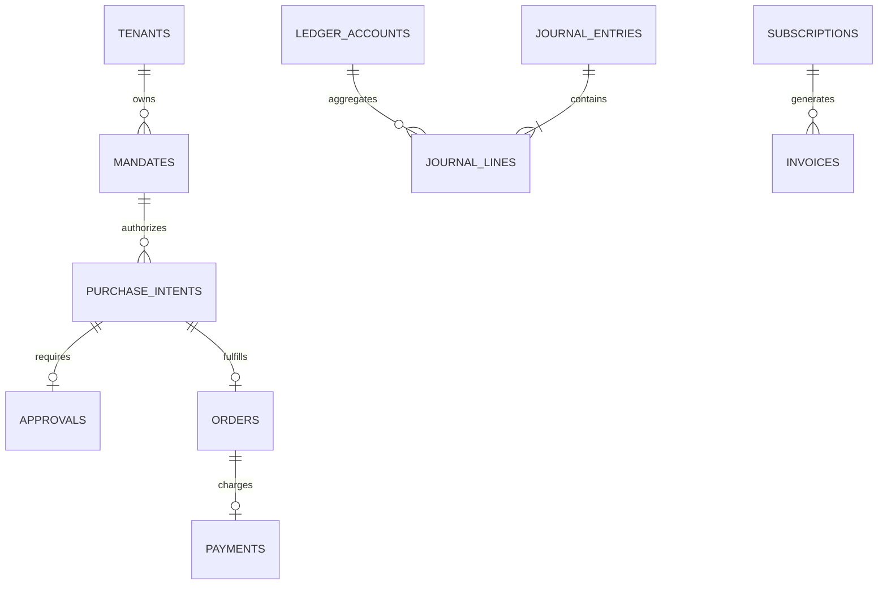

# Database Architecture & Flyway Migrations

Both platforms rely on PostgreSQL 16 (with PostGIS 3.4 for GridDispatch) as their source of ACID truth, utilizing **Flyway** for strictly version-controlled, reproducible schema migrations.

---

## 1. AgentGuard Schema & Double-Entry Ledger Design

### 1.1 ER Diagram


### 1.2 Ledger Integrity Constraint Design
```sql
CREATE TABLE journal_lines (
    id VARCHAR(36) PRIMARY KEY,
    journal_entry_id VARCHAR(36) NOT NULL REFERENCES journal_entries(id) ON DELETE RESTRICT,
    account_id VARCHAR(36) NOT NULL REFERENCES ledger_accounts(id) ON DELETE RESTRICT,
    entry_type VARCHAR(10) NOT NULL CHECK (entry_type IN ('DEBIT', 'CREDIT')),
    amount NUMERIC(19, 4) NOT NULL CHECK (amount > 0),
    tenant_id VARCHAR(64) NOT NULL
);

-- Performance & Isolation Indexing
CREATE INDEX idx_lines_entry ON journal_lines (journal_entry_id);
CREATE INDEX idx_lines_account ON journal_lines (tenant_id, account_id);
CREATE INDEX idx_intents_tenant_agent ON purchase_intents (tenant_id, agent_id);
CREATE INDEX idx_outbox_unprocessed ON outbox_events (published, created_at) WHERE published = false;
```

---

## 2. GridDispatch Schema & PostGIS Spatial Data

### 2.1 PostGIS Geometric Types
```sql
CREATE EXTENSION IF NOT EXISTS postgis;

CREATE TABLE assets (
    id VARCHAR(36) PRIMARY KEY,
    tenant_id VARCHAR(64) NOT NULL,
    code VARCHAR(64) NOT NULL UNIQUE,
    vin VARCHAR(64) NOT NULL UNIQUE,
    asset_type VARCHAR(32) NOT NULL,
    status VARCHAR(32) NOT NULL,
    max_payload_kg NUMERIC(10, 2) NOT NULL,
    battery_capacity_kwh NUMERIC(10, 2) NOT NULL,
    current_battery_percent NUMERIC(5, 2) NOT NULL,
    geom GEOMETRY(Point, 4326),
    current_speed_kmh NUMERIC(8, 2) DEFAULT 0.0,
    created_at TIMESTAMP WITH TIME ZONE DEFAULT NOW()
);

-- Spatial Generalized Search Tree Index
CREATE INDEX idx_assets_geom_gist ON assets USING GIST (geom);
CREATE INDEX idx_warehouses_geom_gist ON warehouses USING GIST (geom);
CREATE INDEX idx_charging_geom_gist ON charging_stations USING GIST (geom);
```

### 2.2 Zero-Oversell Concurrency Invariant Schema
```sql
CREATE TABLE inventory_items (
    id VARCHAR(36) PRIMARY KEY,
    tenant_id VARCHAR(64) NOT NULL,
    warehouse_id VARCHAR(36) NOT NULL REFERENCES warehouses(id),
    sku VARCHAR(64) NOT NULL,
    available_quantity INT NOT NULL CHECK (available_quantity >= 0),
    reserved_quantity INT NOT NULL DEFAULT 0 CHECK (reserved_quantity >= 0),
    safety_stock_level INT NOT NULL DEFAULT 5,
    UNIQUE (tenant_id, warehouse_id, sku)
);
```
The constraint `available_quantity >= 0` guarantees at the database storage engine layer that no phantom overselling can ever succeed, even in the event of an application software bug.
